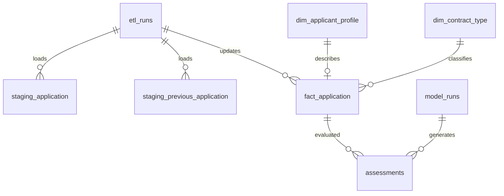

# Thiết kế đã hiện thực

Căn cứ: `proposal-original.md`. Đó là bản thiết kế; repo này hiện thực mới phần database, không phải tìm lại một database đã chạy trước đây.

| Thành phần | Vai trò |
|---|---|
| ops.etl_runs | Trạng thái, timestamps, checksum manifest, row counts, lỗi an toàn |
| staging.application | 21 cột nguồn + metadata; ID unique; TARGET 0/1/NULL |
| staging.previous_application | 7 cột nguồn + metadata; ID previous unique; không ép FK cohort |
| dw.dim_applicant_profile | Một profile/hồ sơ; tuổi, học vấn, thu nhập, gia đình, cờ sở hữu |
| dw.dim_contract_type | Loại hợp đồng và Unknown |
| dw.fact_application | Một dòng/hồ sơ, tiền, lịch sử tổng hợp, nhãn riêng |
| mart.application_features_v1 | Không TARGET; ID chỉ để join, predictor dùng allowlist |
| mart.application_overview_v1 | Hồ sơ đọc web; TARGET chỉ cho analytics/đối chiếu |
| ml.model_runs | Metadata, không có model đã train trong repo |
| ml.assessments | Nhiều lần chấm; snapshot không nhãn; score/status consistency |
| mart.latest_assessment_v1 | Latest success, tie-break ID; không nhân dòng fact |
| app.credit_decisions | Lưu vết quyết định thẩm định của Cán bộ (sql/005_app_decisions.sql) |

## Quyết định MVP
- Tách biệt schema core (`ops`, `staging`, `dw`, `ml`, `mart`) với schema tác vụ ứng dụng (`app.credit_decisions` tại `sql/005_app_decisions.sql`) để giữ nguyên toàn bộ 8 bảng core và kiểm thử tích hợp tự động của Thành viên A.
- Cutoff previous: DAYS_DECISION <= 0. Null/future đếm riêng, không vào aggregate.
- Approval rate = Approved / tất cả hồ sơ previous đủ cutoff. Approved+Refused có thể nhỏ hơn tổng.
- Một dataset cố định sau lần thành công đầu. Đổi manifest thì dùng DB mới, không reset/xóa assessments cũ.
- ETL lỗi rollback staging/DW; failure log ghi ngoài transaction dữ liệu. Parse/header/duplicate sai thì dừng toàn batch.
- Surrogate keys giữ nguyên khi rerun. Tiền âm/source score sai miền giữ staging, DW chuyển NULL kèm cleaning counts.
- Khác nhẹ đề xuất: FK ghép cưỡng chế profile đúng source ID; trigger giữ metadata model đã được dùng.

## Giới hạn & Triển khai Cloud
- Hệ thống được triển khai trên **Neon Cloud** (PostgreSQL 18.6 - AWS Singapore):
  - **Dung lượng & Dữ liệu:** Nạp đầy đủ 100% dữ liệu gốc Home Credit gồm `staging.application` (`307,511` hồ sơ), `staging.previous_application` (`1,670,214` giao dịch lịch sử) và `dw.fact_application` (`307,511` hồ sơ). Tổng dung lượng chiếm `485.36 MB` (nằm gọn trong hạn mức 1 GB, không cần truncate bất kỳ bảng staging nào).
  - **Bảo toàn dữ liệu lịch sử:** Lưu trữ nguyên vẹn toàn bộ 1.67 triệu dòng lịch sử vay tại `staging.previous_application` để phục vụ audit trail, kiểm tra chất lượng dữ liệu (Data Quality Guardrails) và tổng hợp tính toán các chỉ số hành vi tín dụng quá khứ.
  - **Bảng tác vụ ứng dụng:** Bảng `app.credit_decisions` (khởi tạo qua `sql/005_app_decisions.sql`) lưu vết nguyên tử quyết định thẩm định thực tế của cán bộ tín dụng trực tiếp trên Cloud.
- Chưa có train/predict/API/UI trong schema DB core; dữ liệu model trong tests chỉ kiểm tra constraint.
- DB không kiểm chứng file artifact tồn tại/load được; module ML phải kiểm tra trước đăng ký. Trigger không ngăn người dùng sửa file ngoài DB.
- Chưa có dataset versioning/CDC/incremental. Bootstrap IF NOT EXISTS không thay thế migration cho schema cũ.
- Schema/view đầy đủ tên và kiểu cột nằm trong sql/001_schema.sql, sql/002_views.sql và sql/005_app_decisions.sql.
