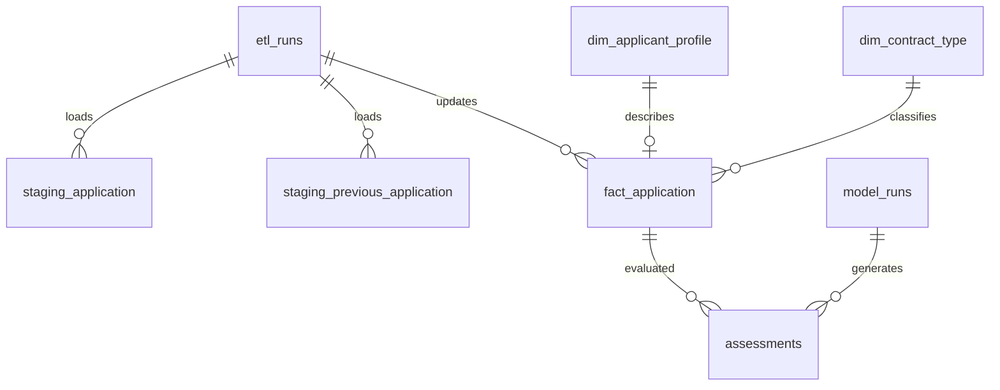

# Thiết kế đã hiện thực

Căn cứ: `proposal-original.md`. Đó là bản thiết kế; repo này hiện thực mới phần database, không phải tìm lại một database đã chạy trước đây.

| Thành phần | Vai trò |
|---|---|
| ops.etl_runs | Trạng thái, timestamps, checksum manifest, row counts, lỗi an toàn |
| staging.application | 21 cột nguồn + metadata; ID unique; TARGET 0/1/NULL |
| staging.previous_application | 7 cột nguồn + metadata; ID previous unique; không ép FK cohort |
| dw.dim_applicant_profile | Một profile/hồ sơ; tuổi, học vấn, thu nhập, gia đình, cờ sở hữu |
| dw.dim_contract_type | Loại hợp đồng và Unknown |
| dw.fact_application | Một dòng/hồ sơ, tiền, lịch sử tổng hợp, nhãn riêng |
| mart.application_features_v1 | Không TARGET; ID chỉ để join, predictor dùng allowlist |
| mart.application_overview_v1 | Hồ sơ đọc web; TARGET chỉ cho analytics/đối chiếu |
| ml.model_runs | Metadata, không có model đã train trong repo |
| ml.assessments | Nhiều lần chấm; snapshot không nhãn; score/status consistency |
| mart.latest_assessment_v1 | Latest success, tie-break ID; không nhân dòng fact |

## Quyết định MVP
- Chỉ core; chưa tạo hai bảng tùy chọn fact_previous_application và credit_decisions.
- Cutoff previous: DAYS_DECISION <= 0. Null/future đếm riêng, không vào aggregate.
- Approval rate = Approved / tất cả hồ sơ previous đủ cutoff. Approved+Refused có thể nhỏ hơn tổng.
- Một dataset cố định sau lần thành công đầu. Đổi manifest thì dùng DB mới, không reset/xóa assessments cũ.
- ETL lỗi rollback staging/DW; failure log ghi ngoài transaction dữ liệu. Parse/header/duplicate sai thì dừng toàn batch.
- Surrogate keys giữ nguyên khi rerun. Tiền âm/source score sai miền giữ staging, DW chuyển NULL kèm cleaning counts.
- Khác nhẹ đề xuất: FK ghép cưỡng chế profile đúng source ID; trigger giữ metadata model đã được dùng.

## Giới hạn
- Mới chạy PostgreSQL thật với dữ liệu synthetic, chưa chạy full Home Credit.
- Chưa có train/predict/API/UI; dữ liệu model trong tests chỉ kiểm tra constraint.
- DB không kiểm chứng file artifact tồn tại/load được; module ML phải kiểm tra trước đăng ký. Trigger không ngăn người dùng sửa file ngoài DB.
- Chưa có dataset versioning/CDC/incremental. Bootstrap IF NOT EXISTS không thay thế migration cho schema cũ.
- Schema/view đầy đủ tên và kiểu cột nằm trong sql/001_schema.sql và sql/002_views.sql.
